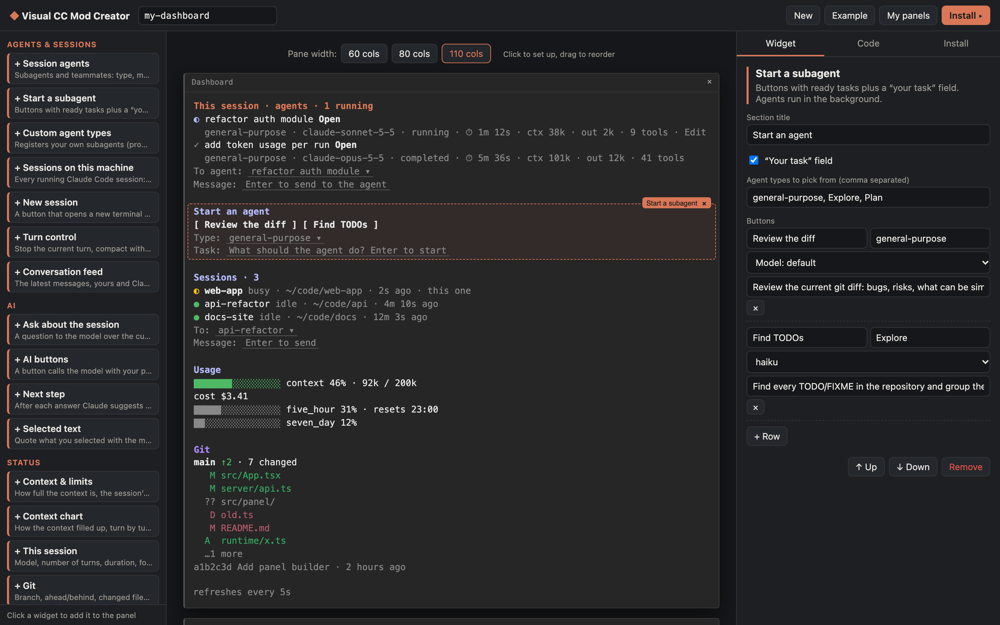
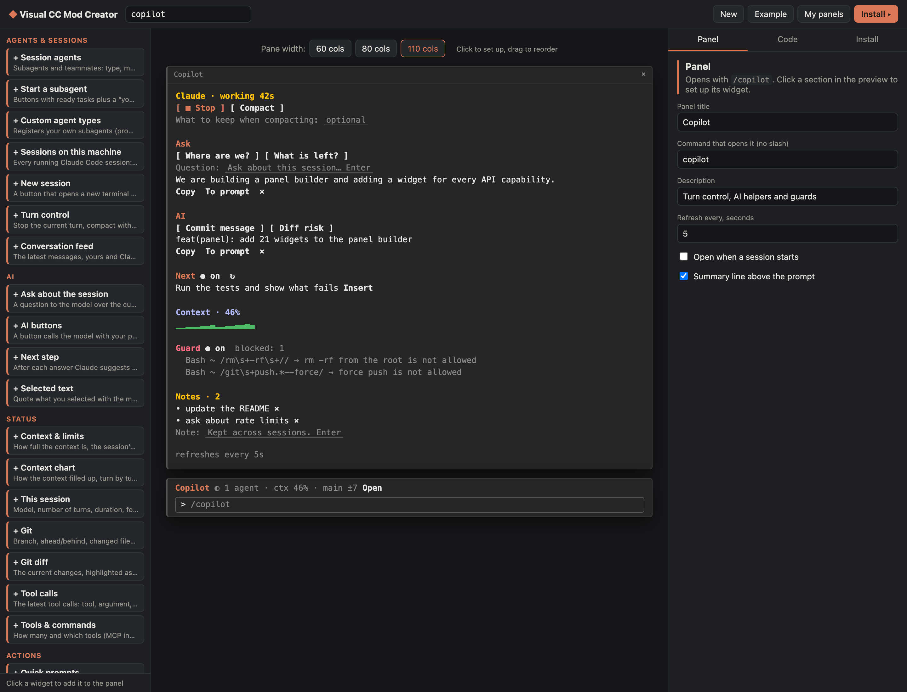
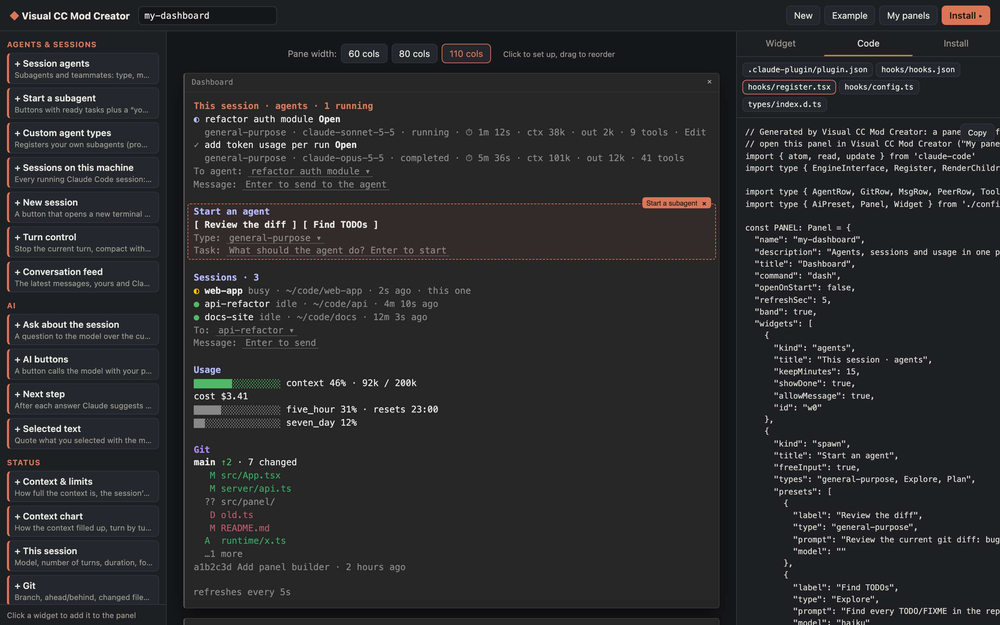
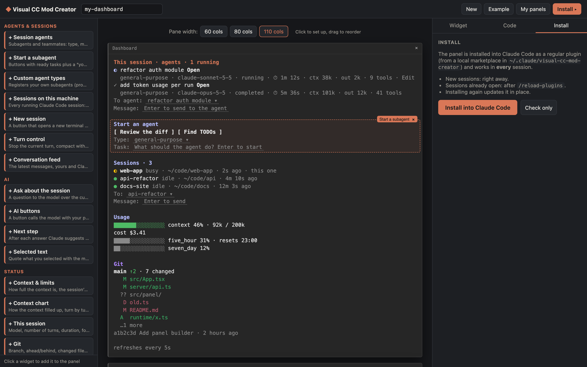
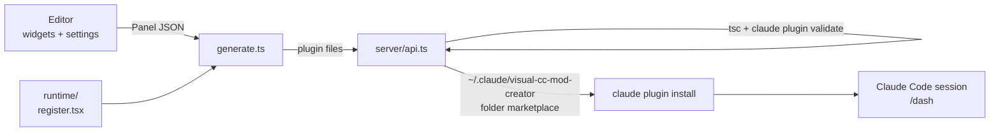

# Visual CC Mod Creator

A visual builder for [Claude Code](https://docs.claude.com/en/docs/claude-code) panes. Pick widgets, arrange them in a live terminal preview, and install the result into Claude Code with one click. No hook code to write.


A panel is a regular Claude Code plugin (a "mod" built on function hooks). It opens with its own slash command, such as `/dash`, and can add a one-line summary above the prompt. It works in every session once installed.

## What it looks like

**Set up a widget.** Click a section in the preview: its settings open on the right. Drag sections to reorder them, and click the pane title to rename it.



**AI helpers and behaviour.** Turn control, questions about the session, AI buttons over a command’s output, next-step suggestions, a context chart, guards that block tool calls, and notes kept across sessions.



**The code it generates.** The Code tab shows the exact files of the plugin, updated as you edit.



**One-click install.** The builder type-checks and validates the plugin, then installs it with `claude plugin install`.



## Widgets

34 widgets in six groups:

| Group | Widgets |
| --- | --- |
| Agents & sessions | **Session agents** (status, model, time, context, tokens; open a transcript, message an agent) · **Start a subagent** · **Custom agent types** · **Sessions on this machine** (message another session) · **New session** in Terminal/iTerm · **Turn control** (stop, compact with instructions, /clear) · **Conversation feed** |
| AI | **Ask about the session** · **AI buttons** (a prompt plus a command’s output as context, or classify into labels) · **Next step** suggestion · **Selected text** (quote it, or ask about it) |
| Status | **Context & limits** · **Context chart** · **This session** · **Git** · **Git diff** · **Tool calls** · **Tools & commands** |
| Actions | **Quick prompts** · **Command buttons** with a dropdown of every command · **Pick an option** into a prompt template · **Clipboard snippets** |
| Data | **Command output** on a timer · **File** · **Note** (Markdown) · **Links** · **HTTP / API** (a value from JSON) · **MCP tool** · **Image** (kitty, Ghostty) · **Notes** kept across sessions |
| Behaviour | **Sound & notifications** when a long turn ends · **Guards** that block tool calls by regex · **System prompt addition** · **Tool for Claude** (a shell command Claude can call) |

## Requirements

- Claude Code with function-hook plugins (mods); tested with 2.1.301
- Node.js 20+
- macOS for the “open a new session” buttons (everything else is platform independent)

## Run it

```bash
git clone https://github.com/Vudaperep/Visual-cc-mod-creator.git
cd Visual-cc-mod-creator
npm install
npm run sync-types   # optional: lets the builder type-check what it generates
npm run dev          # http://127.0.0.1:5177
```

Build a panel, open the **Install** tab and press **Install into Claude Code**. Then, in a running session, run `/reload-plugins` and the panel’s command (`/dash` in the example). New sessions load it on their own.

## How the code works

```
runtime/                  the panel plugin itself, copied into every panel
  hooks/register.tsx      every widget: data, refresh timers, hooks, drawing
  hooks/config.ts         the Panel and Widget types (shared with the editor)
  types/index.d.ts        the values the panel keeps in $.state
src/                      the editor (React + Vite)
  panel/widgets.ts        the widget catalog: title, group, defaults, settings fields
  panel/Preview.tsx       the terminal preview, drawn from mock data
  panel/PanelEditor.tsx   palette, preview, settings, Code and Install tabs
  panel/generate.ts       Panel → the plugin’s files
  components/Install.tsx  install, update, uninstall, “My panels”
server/api.ts             local API in the Vite dev server: check, install, launch
scripts/                  type sync, screenshots, the end-to-end panel test
```



### The runtime

The whole panel is one plugin module, `runtime/hooks/register.tsx`. The editor never generates code per widget: it writes the panel’s design into the runtime as a constant, and the runtime draws whatever that constant lists.

```ts
const PANEL: Panel = {
  "name": "my-dashboard",
  "title": "Dashboard",
  "command": "dash",
  "refreshSec": 5,
  "band": true,
  "widgets": [
    { "id": "w0", "kind": "agents", "title": "This session · agents", "showDone": true, ... },
    { "id": "w1", "kind": "spawn", "title": "Start an agent", "presets": [...] },
    ...
  ]
}
```

The runtime registers the hooks the widgets need: `session.start` (the slash command, timers, custom tools and agent types), `turn.start` / `turn.complete` / `turn.step` (turn state, subagent tokens, alerts, next-step suggestions), `tool.call` (guards, the panel’s own tools, the tool-call log), `prompt.compose` (system prompt additions), and `ui.render` for the `Pane` and the line `AbovePrompt`. Data lives in `$.state` atoms, so a refresh redraws only what reads it:

```tsx
case 'git': {
  const g = await read($, S_git)          // refreshed by a timer and after each turn
  rows.push(head(w, 'merged'))
  rows.push(
    <Text key={`${w.id}-br`}>
      <Text bold>{g.branch}</Text>
      {g.ahead ? <Text color="success"> ↑{g.ahead}</Text> : ''} · {g.files.length} changed
    </Text>,
  )
  ...
}
```

`src/panel/generate.ts` puts the panel’s name and command into the runtime’s placeholders and writes five files: `.claude-plugin/plugin.json`, `hooks/hooks.json`, `hooks/register.tsx`, `hooks/config.ts` and `types/index.d.ts`.

### Install

**Install** writes the plugin to `~/.claude/visual-cc-mod-creator/plugins/<name>`, lists it in a local folder marketplace (`visual-cc-mods`), and runs `claude plugin install <name>@visual-cc-mods`. Because the marketplace is a folder, installing again updates the plugin in place, and `/reload-plugins` picks it up. Before installing, the builder type-checks the plugin (when types are synced) and runs `claude plugin validate`.

The editor’s own copy of the design is saved beside the plugin, so **My panels** can open it again.

### Claude Code types

The plugin API declarations come from Claude Code itself and are not part of this repository. `npm run sync-types` copies them into `vendor/` (ignored by git) from a mod Claude Code has already loaded, or from the copy the `plugin-authoring` skill writes. Without them the builder still works; it only skips the TypeScript check.

## Add a widget

1. **Shape**: add a `kind` and its settings to the `Widget` union in `runtime/hooks/config.ts`.
2. **Catalog**: add an entry to `WIDGETS` in `src/panel/widgets.ts`: title, group, description, defaults (`make`) and the settings fields the editor shows.
3. **Runtime**: draw it in the `ui.render` Pane hook in `runtime/hooks/register.tsx`, and fetch its data in a `refresh…` function (or a hook) if it has any. Keep values a drawing reads in `$.state` (`runtime/types/index.d.ts`).
4. **Preview**: add a case with mock data to `WidgetPreview` in `src/panel/Preview.tsx`.
5. **Test**: give it sample data in `scripts/seed-panel.py` and run `npm run test:panel`.

## Tests

```bash
npm run test:panel
```

This generates a panel with every widget, then type-checks it, validates it with `claude plugin validate`, seeds it with sample data, and runs `claude plugin test`. The test draws the pane and the summary line on the terminal, desktop, VS Code and mobile surfaces, and checks that a guard blocks a matching tool call.

`node scripts/screenshots.mjs [url]` retakes the screenshots in `docs/` from a running builder, with headless Chrome.

## Uninstall a panel

Open **My panels** and press **Uninstall**, or run `claude plugin uninstall <name>@visual-cc-mods`.

## License

MIT, see [LICENSE](LICENSE).
