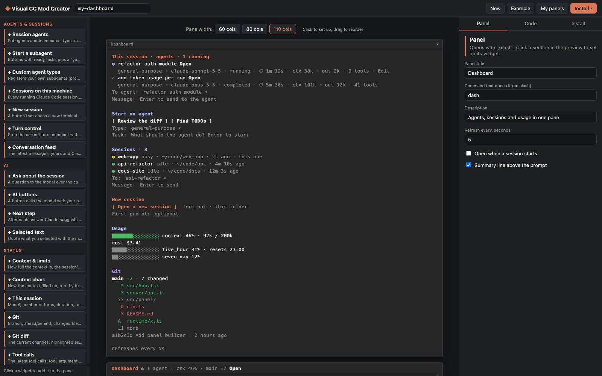

# Visual CC Mod Creator

A visual builder for [Claude Code](https://docs.claude.com/en/docs/claude-code) panes. Pick widgets, arrange them in a live terminal preview, and install the result into Claude Code with one click. No hook code to write.



A panel is a regular Claude Code plugin (a "mod" built on function hooks). It opens with its own slash command, such as `/dash`, and can add a one-line summary above the prompt.

## Widgets

| Group | Widgets |
| --- | --- |
| Agents & sessions | Session agents (status, model, time, context, tokens; open a transcript, message an agent) · Start a subagent · Custom agent types · Sessions on this machine (message another session) · New session in Terminal/iTerm · Turn control (stop, compact with instructions, /clear) · Conversation feed |
| AI | Ask about the session · AI buttons (prompt + command output as context, or classify into labels) · Next step suggestion · Quote or ask about the selected text |
| Status | Context & limits · Context chart · This session · Git · Git diff · Tool calls · Tools & commands |
| Actions | Quick prompts · Command buttons with a dropdown of every command · Pick an option into a prompt template · Clipboard snippets |
| Data | Command output on a timer · File · Note (Markdown) · Links · HTTP / API (a value from JSON) · MCP tool · Image (kitty, Ghostty) · Notes kept across sessions |
| Behaviour | Sound & notifications when a long turn ends · Guards that block tool calls by regex · System prompt addition · A tool Claude can call (a shell command) |

## Requirements

- Claude Code with function-hook plugins (mods); tested with 2.1.301
- Node.js 20+
- macOS for the “open a new session” buttons (everything else is platform independent)

## Run it

```bash
npm install
npm run sync-types   # optional: lets the builder type-check what it generates
npm run dev          # http://127.0.0.1:5177
```

Build a panel, open the **Install** tab and press **Install into Claude Code**. Then, in a running session, run `/reload-plugins` and the panel’s command (`/dash` in the example). New sessions load it on their own.

## How it works

- `runtime/` is the panel plugin itself: `hooks/register.tsx` draws every widget and keeps their data; `hooks/config.ts` is the panel’s shape; `types/index.d.ts` declares the values it keeps in `$.state`.
- `src/panel/generate.ts` writes a panel’s config and names into that runtime. The **Code** tab shows the exact files.
- **Install** writes the plugin to `~/.claude/visual-cc-mod-creator/plugins/<name>`, lists it in a local folder marketplace (`visual-cc-mods`), and runs `claude plugin install <name>@visual-cc-mods`. Because the marketplace is a folder, installing again updates the plugin in place.
- Before installing, the builder type-checks the plugin (when types are synced) and runs `claude plugin validate`.
- `server/api.ts` is the local API behind it, served by the Vite dev server on `127.0.0.1` only.

### Claude Code types

The plugin API declarations come from Claude Code itself and are not part of this repository. `npm run sync-types` copies them into `vendor/` (ignored by git) from a mod Claude Code has already loaded, or from the copy the `plugin-authoring` skill writes. Without them the builder still works; it only skips the TypeScript check.

## Tests

```bash
npm run test:panel
```

This generates a panel with every widget, then type-checks it, validates it with `claude plugin validate`, seeds it with sample data, and runs `claude plugin test`. The test draws the pane and the summary line on the terminal, desktop, VS Code and mobile surfaces, and checks that a guard blocks a matching tool call.

## Uninstall a panel

Open **My panels** and press **Uninstall**, or run `claude plugin uninstall <name>@visual-cc-mods`.

## License

MIT, see [LICENSE](LICENSE).
