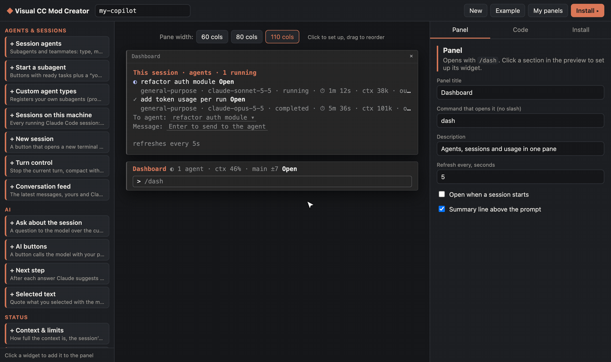

# Visual CC Mod Creator

A visual builder for [Claude Code](https://docs.claude.com/en/docs/claude-code) panes. Pick widgets, arrange them in a live terminal preview, and install the result into Claude Code with one click. No hook code to write.



A panel is a regular Claude Code plugin (a "mod" built on function hooks). It opens with its own slash command, such as `/dash`, and can add a one-line summary above the prompt. It works in every session once installed.

## What it looks like

Click a section in the preview to set it up on the right, drag sections to reorder them, and click the pane title to rename it. A panel can mix agents and sessions with AI helpers and behaviour: turn control, questions about the session, AI buttons over a command’s output, next-step suggestions, guards that block tool calls, notes kept across sessions.


The **Code** tab shows the exact files of the plugin, updated as you edit. **Install** type-checks and validates them, then installs the plugin with `claude plugin install`.


## Widgets

34 widgets in six groups:

| Group | Widgets |
| --- | --- |
| Agents & sessions | **Session agents** (status, model, time, context, tokens; open a transcript, message an agent) · **Start a subagent** · **Custom agent types** · **Sessions on this machine** (message another session) · **New session** in Terminal/iTerm · **Turn control** (stop, compact with instructions, /clear) · **Conversation feed** |
| AI | **Ask about the session** · **AI buttons** (a prompt plus a command’s output as context, or classify into labels) · **Next step** suggestion · **Selected text** (quote it, or ask about it) |
| Status | **Context & limits** · **Context chart** · **This session** · **Git** · **Git diff** · **Tool calls** · **Tools & commands** |
| Actions | **Quick prompts** · **Command buttons** with a dropdown of every command · **Pick an option** into a prompt template · **Clipboard snippets** |
| Data | **Command output** on a timer · **File** · **Note** (Markdown) · **Links** · **HTTP / API** (a value from JSON) · **MCP tool** · **Image** (kitty, Ghostty) · **Notes** kept across sessions |
| Behaviour | **Sound & notifications** when a long turn ends · **Guards** that block tool calls by regex · **System prompt addition** · **Tool for Claude** (a shell command Claude can call) |

## Requirements

- Claude Code with function-hook plugins (mods); tested with 2.1.301
- Node.js 20+
- macOS for the “open a new session” buttons (everything else is platform independent)

## Run it

```bash
git clone https://github.com/Vudaperep/Visual-cc-mod-creator.git
cd Visual-cc-mod-creator
npm install
npm run sync-types   # optional: lets the builder type-check what it generates
npm run dev          # http://127.0.0.1:5177
```

Build a panel, open the **Install** tab and press **Install into Claude Code**. Then, in a running session, run `/reload-plugins` and the panel’s command (`/dash` in the example). New sessions load it on their own.

## Add a widget

1. **Shape**: add a `kind` and its settings to the `Widget` union in `runtime/hooks/config.ts`.
2. **Catalog**: add an entry to `WIDGETS` in `src/panel/widgets.ts`: title, group, description, defaults (`make`) and the settings fields the editor shows.
3. **Runtime**: draw it in the `ui.render` Pane hook in `runtime/hooks/register.tsx`, and fetch its data in a `refresh…` function (or a hook) if it has any. Keep values a drawing reads in `$.state` (`runtime/types/index.d.ts`).
4. **Preview**: add a case with mock data to `WidgetPreview` in `src/panel/Preview.tsx`.
5. **Test**: give it sample data in `scripts/seed-panel.py` and run `npm run test:panel`.

## Tests

```bash
npm run test:panel
```

This generates a panel with every widget, then type-checks it, validates it with `claude plugin validate`, seeds it with sample data, and runs `claude plugin test`. The test draws the pane and the summary line on the terminal, desktop, VS Code and mobile surfaces, and checks that a guard blocks a matching tool call.

`node scripts/screenshots.mjs [url]` retakes the screenshots in `docs/`, and `node scripts/demo-gif.mjs [url]` records `docs/demo.gif` (needs ffmpeg), both from a running builder with headless Chrome.

## Uninstall a panel

Open **My panels** and press **Uninstall**, or run `claude plugin uninstall <name>@visual-cc-mods`.

## License

MIT, see [LICENSE](LICENSE).
